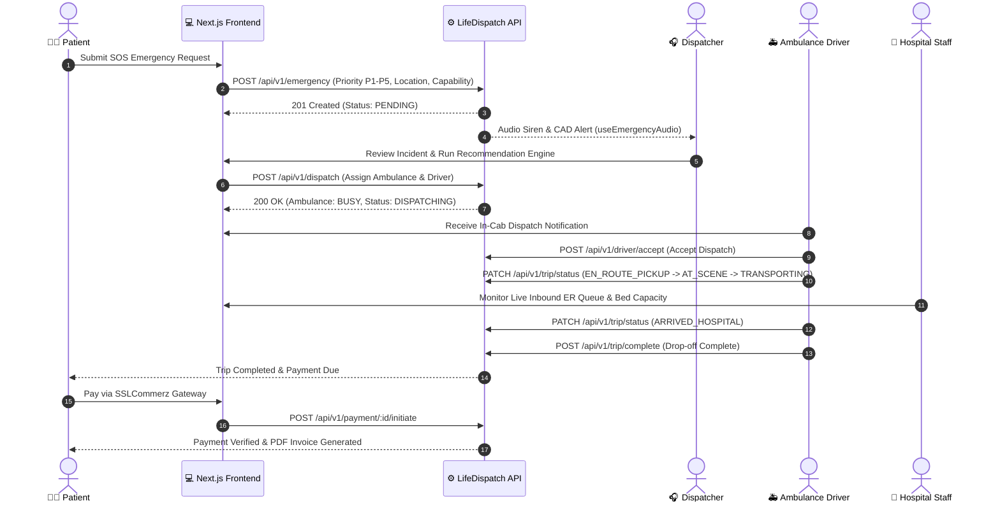

<div align="center">

  

  # LifeDispatch (Frontend)
  ### Intelligent Emergency Medical Dispatch (CAD), Fleet Telematics & Hospital Orchestration Grid

  <p align="center">
    A production-grade Emergency Medical Services (EMS) web application coordinating the complete emergency lifecycle — from patient distress calls and Computer-Aided Dispatch (CAD) to ambulance telematics, hospital diversion management, and automated payment.
  </p>

  <p align="center">
    <a href="https://nextjs.org"></a>
    <a href="https://react.dev"></a>
    <a href="https://www.typescriptlang.org/"></a>
    <a href="https://tailwindcss.com"></a>
    <a href="https://tanstack.com/query"></a>
    <a href="https://biomejs.dev"></a>
    <a href="https://github.com/webpromahdi/lifedispatch-backend"></a>
    <a href="LICENSE"></a>
  </p>

  <p align="center">
    <a href="https://github.com/webpromahdi/lifedispatch-backend"><strong>Explore Backend Repository »</strong></a>
    <br />
    <br />
    <a href="#-quickstart--installation">Quickstart</a>
    ·
    <a href="#-role-based-access-control-rbac--demo-credentials">Demo Credentials</a>
    ·
    <a href="#-system-architecture--dispatch-lifecycle">Architecture</a>
    ·
    <a href="#-key-features">Key Features</a>
    ·
    <a href="#-environment-variables">Environment Setup</a>
  </p>

</div>

---

## 📑 Table of Contents

- [Overview & The Problem LifeDispatch Solves](#-overview--the-problem-lifedispatch-solves)
- [System Architecture & Dispatch Lifecycle](#-system-architecture--dispatch-lifecycle)
- [Role-Based Access Control (RBAC) & Demo Credentials](#-role-based-access-control-rbac--demo-credentials)
- [Key Features](#-key-features)
  - [Intelligent CAD & Web Audio API Siren Engine](#1-intelligent-cad--web-audio-api-siren-engine)
  - [Next.js 16 Edge Proxy & Route Protection](#2-nextjs-16-edge-proxy--route-protection)
  - [Resilient API Layer & Token Refresh Cycle](#3-resilient-api-layer--token-refresh-cycle)
  - [Architectural State Boundary (TanStack Query + Zustand)](#4-architectural-state-boundary-tanstack-query--zustand)
  - [6 Role-Specific Dashboards](#5-6-role-specific-dashboards)
  - [Hospital Bed Capacity & Diversion Grid](#6-hospital-bed-capacity--diversion-grid)
  - [SSLCommerz Payment & PDF Invoicing](#7-sslcommerz-payment--pdf-invoicing)
- [Tech Stack](#-tech-stack)
- [Repository Anatomy](#-repository-anatomy)
- [Environment Variables](#-environment-variables)
- [Quickstart & Installation](#-quickstart--installation)
- [Backend Integration](#-backend-integration)
- [Code Quality & Formatting (Biome)](#-code-quality--formatting-biome)
- [Contributing & License](#-contributing--license)

---

## 🚑 Overview & The Problem LifeDispatch Solves

In traditional Emergency Medical Services (EMS), ambulance dispatching is plagued by manual phone calls, spreadsheet-based fleet tracking, and disjointed hospital communications:
* **Ambulance Double-Booking:** Multiple dispatchers accidentally assign the same ambulance to different calls.
* **Mismatched Medical Capabilities:** Basic Life Support (BLS) units are sent to critical cardiac arrests requiring Advanced Life Support (ALS) equipment or neonatal incubators.
* **Emergency Room Overcrowding:** Ambulances transport critical patients to emergency departments operating at 100% capacity because diversion statuses are updated manually hours too late.
* **Opaque Patient Experience:** Callers wait anxiously without real-time ETA or vehicle status.

**LifeDispatch** solves these challenges with a unified, state-driven platform combining:
1. **Medical Priority Dispatch System (MPDS) Triaging:** Automatic prioritization from **P1 Critical** (lights & sirens) down to **P5 Routine**.
2. **Computer-Aided Dispatch (CAD) Recommendation Engine:** Suggests the optimal ambulance using vehicle status, crew certification levels, capability requirements, and Haversine distance.
3. **Real-Time Hospital Diversion Grid:** Instant visibility into open ER beds and active diversion statuses (`ACCEPTING`, `DIVERTING`, `CLOSED`).
4. **End-to-End Incident Tracking & Payment:** Auditable timestamps for every trip milestone, concluded by on-demand PDF invoice generation and SSLCommerz payment processing.

---

## 🔄 System Architecture & Dispatch Lifecycle

LifeDispatch models the full lifecycle of an emergency through strict finite-state transitions and role-based permissions:



---

## 🔐 Role-Based Access Control (RBAC) & Demo Credentials

The platform enforces a granular **6-role RBAC architecture**. For immediate local evaluation or testing, pre-configured seed accounts are available:

| Role | Dashboard Route | Core Capabilities | Demo Email | Demo Password |
|---|---|---|---|---|
| **`SUPER_ADMIN`** | `/dashboard/super-admin` | Global platform governance, system audit logs, cross-platform financial analytics, admin account provisioning | `superadmin@lifedispatch.com` | `SuperAdmin@123` |
| **`ADMIN`** | `/dashboard/admin` | Operational fleet inventory, driver licensing verification, hospital diversion tracking, emergency cancellations | `admin@lifedispatch.com` | `Admin@123` |
| **`DISPATCHER`** | `/dashboard/dispatcher` | Live CAD emergency queue, P1–P5 priority triaging, automated unit recommendation engine, manual unit override | `dispatcher@lifedispatch.com` | `Dispatcher@123` |
| **`DRIVER`** | `/dashboard/driver` | In-cab dispatch response (Accept/Reject), milestone progression (At Scene, Transporting), route visualization | `driver@lifedispatch.com` | `Driver@123` |
| **`HOSPITAL_STAFF`** | `/dashboard/hospital-staff` | Incoming emergency queue, real-time ER bed counter, facility diversion toggle (`ACCEPTING`, `DIVERTING`, `CLOSED`) | `hospitalstaff@lifedispatch.com` | `HospitalStaff@123` |
| **`PATIENT`** | `/dashboard/patient` | 1-Click distress call (SOS), live ambulance telematics & ETA tracking, trip history, SSLCommerz online checkout | `nafisa.anjum@gmail.com` | `password123` |

---

## 🌟 Key Features

### 1. Intelligent CAD & Web Audio API Siren Engine
* **P1 Critical Audio Siren:** Implemented in `src/hooks/useEmergencyAudio.ts` using the native HTML5 Web Audio API to alert dispatchers the instant a critical life-threatening incident is logged.
* **Autoplay Policy Bypass:** Seamlessly listens for first-gesture user unlock (`pointerdown`, `keydown`) to satisfy browser audio autoplay requirements.
* **Persistent Acknowledgment:** Allows dispatchers to mute, snooze, or individually acknowledge sirens with preferences persisted in Zustand localStorage.

### 2. Next.js 16 Edge Proxy & Route Protection
* Built in `src/proxy.ts` (Next.js 16 routing proxy convention) acting as high-speed edge middleware.
* Decodes JWT access and refresh tokens, validates expiry timestamps, redirects unauthenticated users with preserved redirect destinations (`?from=/target`), and injects `x-user-role` and `x-user-id` headers for downstream processing.
* Injects security headers (`X-Frame-Options: DENY`, `X-Content-Type-Options: nosniff`, `Referrer-Policy: strict-origin-when-cross-origin`).

### 3. Resilient API Layer & Token Refresh Cycle
* Implemented in `src/lib/apiClient.ts` on top of `ofetch` with `credentials: "include"`.
* **Automatic Mutex Token Refresh:** When any protected endpoint returns a `401 Unauthorized`, an asynchronous mutex lock automatically requests a refreshed access token via `/auth/refresh-token`, updates browser session cookies via `/api/v1/auth/session`, and seamlessly replays the original failed request.

### 4. Architectural State Boundary (TanStack Query + Zustand)
* **Strict Separation of Concerns:**
  * **Server / Cache State:** Managed exclusively by `@tanstack/react-query` v5 (emergencies, fleet units, hospitals, trips, audit logs).
  * **Client / UI State:** Managed exclusively by `zustand` v5 (`src/store/useAppStore.ts`) across atomic slices:
    * `createUISlice.ts`: Mobile drawer, responsive modal toggles.
    * `createPreferencesSlice.ts`: Persistent sidebar collapse state, table row density, audio mute toggles.
    * `createAlertSlice.ts`: Dismissed siren IDs, audio playback mirrors.

### 5. 6 Role-Specific Dashboards
* **Super Admin & Admin:** Fleet CRUD dialogs, driver certification tracking, comprehensive audit trails with actor filtering, and Recharts financial breakdown graphs.
* **Dispatcher CAD:** Interactive priority cards (P1 Critical to P5 Routine), one-click capability matching (ALS, BLS, Neonatal, Bariatric), and driver dispatch dispatching.
* **Driver Terminal:** Streamlined mobile-optimized layout with high-contrast milestone action buttons (`Arrived at Scene`, `En Route Hospital`) and reroute indicators.
* **Patient Portal:** Single-tap emergency distress form, ambulance driver contact card, interactive ETA countdown, and downloadable medical trip receipts.

### 6. Hospital Bed Capacity & Diversion Grid
* Hospital managers can dynamically toggle facility diversion status between **Accepting Patients**, **Diverting**, or **Emergency Department Closed**.
* Provides dispatchers and ambulance crews immediate awareness, preventing units from transporting patients to overwhelmed emergency departments.

### 7. SSLCommerz Payment & PDF Invoicing
* Integrated with SSLCommerz gateway in Bangladeshi Taka (BDT).
* Auto-redirects patients to secure checkout upon trip completion, with instantaneous payment status reconciliation (`PAID`, `FAILED`, `CANCELLED`).
* Instant PDF invoice generation for patient insurance claims and corporate reimbursements.

---

## 🛠️ Tech Stack

| Category | Technology | Version | Purpose |
|---|---|---|---|
| **Core Framework** | [Next.js (App Router)](https://nextjs.org/) | `16.3.6` | Server-Side Rendering, Route Groups, Edge Proxy |
| **Language** | [TypeScript](https://www.typescriptlang.org/) | `7.0.2` | Strict compile-time type safety across layouts and APIs |
| **UI Library** | [React](https://react.dev/) | `19.3.0` | React 19 Concurrent rendering & modern hooks |
| **Styling** | [Tailwind CSS](https://tailwindcss.com/) | `v4.0.0` | High-performance CSS utility engine with `@tailwindcss/postcss` |
| **Component Primitives** | [shadcn/ui](https://ui.shadcn.com/) + [Base UI](https://base-ui.com/) | `^4.21.0` / `^1.8.0` | Accessible, unstyled UI primitives customized for LifeDispatch |
| **Server State** | [TanStack React Query](https://tanstack.com/query) | `5.104.1` | Asynchronous cache, background refetching, mutations |
| **Client UI State** | [Zustand](https://zustand-demo.pmnd.rs/) | `5.0.16` | Persistent UI preferences, mobile drawer, audio alert state |
| **Data Fetching** | [ofetch](https://github.com/unjs/ofetch) | `1.5.1` | Lightweight HTTP client with dual token & cookie forwarding |
| **Form Management** | [TanStack React Form](https://tanstack.com/form) | `1.33.5` | Type-safe form validation and state handling |
| **Schema Validation** | [Zod](https://zod.dev/) | `4.6.5` | Form and payload validation schemas |
| **Data Visualization** | [Recharts](https://recharts.org/) | `3.10.1` | Incident priority pie charts and dispatch volume bars |
| **Animations** | [Framer Motion](https://www.framer.com/motion/) | `13.4.4` | Smooth dashboard tab switches and micro-interactions |
| **Icons & Notifications** | [Lucide React](https://lucide.dev/) / [Sonner](https://sonner.emilkowal.ski/) | `1.48.0` / `2.0.8` | Modern iconography and rich stackable toast notifications |
| **Linter & Formatter** | [Biome](https://biomejs.dev/) | `2.5.14` | Sub-millisecond code linting, formatting, and import sorting |

---

## 📂 Repository Anatomy

```text
lifedispatch-frontend/
├── public/                         # Static public assets
│   ├── images/                     # WebP optimized hero and auth backdrops
│   ├── sounds/                     # emergency-siren.mp3 for P1 dispatch alerts
│   └── lifedispatch-logo-master.png# High-resolution platform logos
├── src/
│   ├── api/                        # Typed ofetch API functions
│   │   ├── auth.api.ts             # Login, register, OTP verification, session sync
│   │   ├── emergency.api.ts        # Emergency incident creation, priority updates
│   │   ├── dispatch.api.ts         # Ambulance recommendation & dispatch calls
│   │   ├── driver.api.ts           # Driver acceptance & availability updates
│   │   ├── hospital.api.ts         # Hospital bed capacity & diversion status
│   │   ├── payment.api.ts          # SSLCommerz initiation & status checks
│   │   └── trip.api.ts             # Trip milestone progress & completion
│   ├── app/                        # Next.js 16 App Router
│   │   ├── (public)/               # Public marketing & authentication routes
│   │   │   ├── (auth)/             # /login, /register, /forgot-password, /reset-password
│   │   │   └── (marketting)/       # /about-us, /contact-us
│   │   ├── api/v1/auth/session/    # Next.js Route Handler syncing server cookies
│   │   ├── dashboard/              # 6 Protected Role Dashboards
│   │   │   ├── admin/              # Fleet, drivers, hospitals, emergencies, analytics
│   │   │   ├── dispatcher/         # CAD queue, ambulance recommendation, dispatching
│   │   │   ├── driver/             # In-cab trip status, navigation simulation
│   │   │   ├── hospital-staff/     # ER queue, bed tracker, diversion toggle
│   │   │   ├── patient/            # SOS emergency form, live ETA, payment history
│   │   │   └── super-admin/        # User governance, system audit logs, metrics
│   │   ├── payment/                # /payment/result callback handler
│   │   ├── globals.css             # Tailwind CSS v4 design token definitions
│   │   ├── layout.tsx              # Root HTML layout with providers & fonts
│   │   └── page.tsx                # Marketing landing page
│   ├── components/                 # Reusable UI component architecture
│   │   ├── charts/                 # PriorityPieChart, StatusBreakdownBar
│   │   ├── common/                 # DataTable, StatCard, PriorityBadge, StatusBadge
│   │   ├── forms/                  # LoginForm, RegisterForm, CreateEmergencyForm
│   │   ├── layout/                 # Sidebar, Topbar, DashboardShell, EmergencyAlertBanner
│   │   └── ui/                     # shadcn/ui & Base UI design tokens
│   ├── hooks/                      # Custom TanStack Query & Web Audio hooks
│   │   ├── auth.hook.ts            # useLogin, useGetMe, useRegister
│   │   ├── emergency.hook.ts       # useEmergencies, useCreateEmergency
│   │   ├── useEmergencyAudio.ts    # Web Audio API emergency siren coordinator
│   │   └── useDerivedEmergencyAlert.ts # P1 critical incident detection logic
│   ├── lib/                        # Infrastructure helpers
│   │   ├── apiClient.ts            # ofetch instance with auto token refresh
│   │   ├── demo-roles.ts           # Demo credentials matrix
│   │   └── types/                  # Shared TypeScript interfaces and enums
│   ├── providers/                  # QueryClientProvider & Sonner toast provider
│   ├── store/                      # Zustand persistent state slices
│   │   ├── slices/                 # createUISlice, createPreferencesSlice, createAlertSlice
│   │   └── useAppStore.ts          # Bound persistent store with atomic selector hooks
│   ├── validations/                # Zod validation schemas
│   └── proxy.ts                    # Next.js 16 Edge Proxy & RBAC middleware
├── .env.example                    # Template for development environment variables
├── .env.production                 # Production environment settings
├── biome.json                      # Biome rules and formatter configuration
├── next.config.ts                  # Remote image patterns and Next.js settings
└── package.json                    # Project scripts and dependencies
```

---

## ⚙️ Environment Variables

LifeDispatch requires a single base URL pointing to the running backend API instance.

Create a `.env.local` file in the root directory:

```bash
cp .env.example .env.local
```

| Variable | Description | Development Default | Production Target |
|---|---|---|---|
| `NEXT_PUBLIC_API_BASE_URL` | The fully qualified base URL of the LifeDispatch REST API | `http://localhost:5000/api/v1` | `https://lifedispatch-backend.vercel.app/api/v1` |

> [!NOTE]
> When deploying to **Vercel**, configure `NEXT_PUBLIC_API_BASE_URL` in **Project Settings → Environment Variables**.

---

## 🚀 Quickstart & Installation

### Prerequisites
* **Node.js**: `≥20.9.0` (LTS recommended)
* **Package Manager**: `npm` (bundled with Node) or `pnpm`
* **LifeDispatch Backend**: Local instance or remote deployed API ([Backend Setup Guide](https://github.com/webpromahdi/lifedispatch-backend))

### Step 1: Clone the Repository
```bash
git clone https://github.com/webpromahdi/lifedispatch-frontend.git
cd lifedispatch-frontend
```

### Step 2: Install Dependencies
```bash
npm install
```

### Step 3: Configure Environment
```bash
# Copy example environment configuration
cp .env.example .env.local

# Ensure NEXT_PUBLIC_API_BASE_URL points to your backend instance
```

### Step 4: Run the Development Server
```bash
npm run dev
```

Open [http://localhost:3000](http://localhost:3000) with your browser to experience LifeDispatch.

### Step 5: Build for Production
```bash
npm run build
npm run start
```

---

## 🔗 Backend Integration

This frontend is designed to run against the **LifeDispatch Backend API**:
* **Backend Repository:** [https://github.com/webpromahdi/lifedispatch-backend](https://github.com/webpromahdi/lifedispatch-backend)
* **Backend Stack:** Node.js · Express.js · Prisma ORM 7 · PostgreSQL · Redis · Passport.js · Zod · Cloudinary · SSLCommerz

### Key API Integration Contracts

| Service | Backend Endpoint | Frontend Hook |
|---|---|---|
| **Authentication** | `POST /api/v1/auth/login` | `useLogin()` (`src/hooks/auth.hook.ts`) |
| **Session Hydration** | `GET /api/v1/auth/me` | `useGetMe()` (`src/hooks/auth.hook.ts`) |
| **Token Refresh** | `POST /api/v1/auth/refresh-token` | `refreshTokens()` (`src/lib/apiClient.ts`) |
| **Emergency Stream** | `GET /api/v1/emergency` | `useEmergencies()` (`src/hooks/emergency.hook.ts`) |
| **Ambulance Triage** | `POST /api/v1/dispatch` | `useCreateDispatch()` (`src/hooks/dispatch.hook.ts`) |
| **Trip Updates** | `PATCH /api/v1/trip/:id/status` | `useUpdateTripStatus()` (`src/hooks/trip.hook.ts`) |
| **Hospital Capacity** | `PATCH /api/v1/hospital/:id/diversion` | `useUpdateDiversion()` (`src/hooks/hospital.hook.ts`) |
| **SSLCommerz Pay** | `POST /api/v1/payment/:id/initiate` | `initiatePayment()` (`src/api/payment.api.ts`) |

---

## 🧹 Code Quality & Formatting (Biome)

This project uses [Biome](https://biomejs.dev) as its sole, blazing-fast linter and formatter.

```bash
# Check code for linting errors
npm run lint

# Automatically format code according to Biome standards
npm run format

# Run comprehensive check (lint + format + safe auto-fixes)
npm run check
```

---

## 📄 Contributing & License

Distributed under the **MIT License**. See `LICENSE` for more information.

Developed with ❤️ for mission-critical emergency healthcare coordination.

For inquiries, support, or backend integration queries, visit the [Backend Repository](https://github.com/webpromahdi/lifedispatch-backend).
